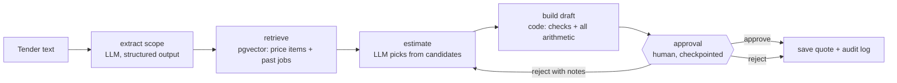

# Tender Desk

A small multi-agent estimating assistant for a construction business. It reads a request for quotation, works out the scope, prices each item from a supplier price list, drafts a quote with a margin taken from comparable past jobs, and **stops for a person to approve or reject it** before anything is saved.

All data in this repo is invented. No real business, supplier or client is represented.

## How it works



Design rules, each enforced in code and covered by a test:

- **The model picks, the code adds up.** The model chooses a price item from the candidates retrieved for each scope item. Quantities, line totals, subtotal, margin and total are all computed in Python.
- **The model can't invent a price item.** A choice that wasn't offered is rejected and flagged.
- **Flags a reviewer can trust.** Unit mismatches (after normalising `m²`/`m2`, `lin m`/`m`, `lump sum`/`each`), no match, low confidence and below-policy margin are all flagged on the draft.
- **Nothing is saved until a person decides.** LangGraph `interrupt()` pauses the run and the state is checkpointed. Every step writes to an audit log.
- **Tender text is treated as untrusted** in the prompts. (Adversarial testing of this is a separate project, not done yet.)
- **Hard spend limits.** The OpenRouter client refuses to call the API past a per-run cap, a project cap, or when the account balance would drop below a floor. `uv run spend` shows the live numbers.

## Run it

```bash
docker compose up -d                       # Postgres 17 + pgvector, seeded from sql/
uv sync
uv run python scripts/seed.py              # invented price list, 30 past jobs
uv run pytest                              # 16 tests, no API cost
uv run python scripts/demo.py examples/tender_rear_extension.txt   # live run, about $0.0005
uv run spend                               # balance, project spend
```

The model key is read from `OPENROUTER_API_KEY` or `~/.config/openrouter/key`. Model is configurable: `TENDER_DESK_MODEL` (default `deepseek/deepseek-v4-flash`).

## Status and honest limits

Working: the full workflow, 16 passing tests (model replaced by a scripted fake, real Postgres), live runs on a real model.

What a single live run has shown so far (one tender, one model, not an evaluation):
- It priced an 11-line rear extension for $23,594.44 including margin, with no flags, for $0.00045.
- Two defects surfaced on the first live run and are fixed with tests: a unit check that flagged `m²` against `m2`, and a model answer that was cut off mid-JSON when the scope grew.

Known weakness, kept visible on purpose: vector search over the price list is imperfect. "scaffold for two storey walls" does not return "Scaffold hire per week" in the top 3. The workflow tolerates this (the model can answer "no match" and the line is flagged), but retrieval quality needs measuring and improving. That is the next project (RAG with an evaluation harness).

Not done yet: a Postgres checkpointer for the live run (the demo uses an in-memory one), an HTTP API and approval screen, an evaluation set with measured accuracy, guardrail and prompt-injection tests, observability.
