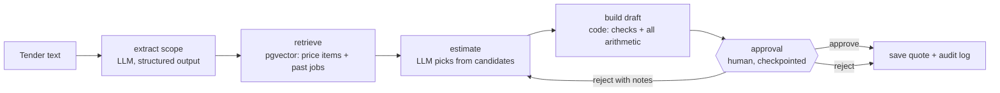

# Tender Desk

A small multi-agent estimating assistant for a construction business. It reads a request for quotation, works out the scope, prices each item from a supplier price list, drafts a quote with a margin taken from comparable past jobs, and **stops for a person to approve or reject it** before anything is saved.

All data in this repo is invented. No real business, supplier or client is represented.

## How it works



Design rules, each enforced in code and covered by a test:

- **The model picks, the code adds up.** The model chooses a price item from the candidates retrieved for each scope item. Quantities, line totals, subtotal, margin and total are all computed in Python.
- **The model can't invent a price item.** A choice that wasn't offered is rejected and flagged.
- **Flags a reviewer can trust.** Unit mismatches (after normalising `m²`/`m2`, `lin m`/`m`, `lump sum`/`each`), no match, low confidence and below-policy margin are all flagged on the draft.
- **Nothing is saved until a person decides.** LangGraph `interrupt()` pauses the run and the state is checkpointed. Every step writes to an audit log.
- **Tender text is treated as untrusted** in the prompts. (Adversarial testing of this is a separate project, not done yet.)
- **Hard spend limits.** The OpenRouter client refuses to call the API past a per-run cap, a project cap, or when the account balance would drop below a floor. `uv run spend` shows the live numbers.

## Run it

```bash
docker compose up -d                       # Postgres 17 + pgvector, seeded from sql/
uv sync
uv run python scripts/seed.py              # invented price list, 30 past jobs
uv run pytest                              # 19 tests, no API cost
uv run python scripts/demo.py examples/tender_rear_extension.txt   # live run, about $0.0005
uv run spend                               # balance, project spend
```

The model key is read from `OPENROUTER_API_KEY` or `~/.config/openrouter/key`. Model is configurable: `TENDER_DESK_MODEL` (default `deepseek/deepseek-v4-flash`).

## Evaluation

74 labelled queries against the 66-item catalogue: 66 real ones (one per item, written in tender language, not copied from catalogue names) and 8 for work that is not in the catalogue. Split 29 tuning / 45 held-out before any scoring. Nothing was tuned on the held-out set.

```bash
uv run python -m tender_desk.evals.retrieval --split test --write
uv run python -m tender_desk.evals.selection --model deepseek/deepseek-v4-flash --run-cap 0.10 --write
```

### 1. Retrieval: is the right item in what the model is shown?

The model sees the top 4 candidates, so **hit@4** is the number that matters. Held-out set, 39 real queries:

| strategy | hit@1 | hit@4 | MRR | median ms |
|---|---|---|---|---|
| **vector search, as shipped** | 90% | **92%** (36/39) | 0.917 | 13 |
| vector + BGE query instruction | 90% | 92% | 0.917 | 13 |
| vector, catalogue embedded by name only | 87% | 90% | 0.887 | 13 |
| hybrid (vector + BM25, rank fusion) | 82% | 90% | 0.862 | 22 |
| BM25 keyword only | 67% | 82% | 0.744 | 0.3 |

- On the 29-query tuning set the hybrid looked slightly better at hit@4 (100% against 96%, a difference of **one query**). On the held-out set that lead disappeared. So production stays on plain vector search.
- Every miss is **trade slang**: "sparky hours", "chippy hours for the fit out", "cart away excess spoil", "plastic underlay beneath slab". Hit@4 by kind: spec 100%, paraphrase 100%, tender-style 100%, **jargon 73%**.
- The in-memory search used for comparison is tested to return the same top 4 as the production pgvector query.

### 2. Selection: given the candidates, does the model pick the right one?

All 74 queries, production prompt, production retrieval. A pick outside the offered candidates counts as wrong, because the workflow rejects it.

| model | end to end (66 real) | when right item was offered | wrong picks | picked an item not offered | false match on 8 not-in-catalogue | cost |
|---|---|---|---|---|---|---|
| deepseek-v4-flash | 92.4% (61/66) | 98.4% (61/62) | 0 | 0 | 0 of 8 | $0.002 |
| claude-haiku-5.5 | 93.9% (62/66) | 100% (62/62) | 0 | 1 | 0 of 8 | $0.006 |
| claude-sonnet-5.5 | 93.9% (62/66) | 100% (62/62) | 0 | 1 | 0 of 8 | $0.084 |

- Once the right item is in front of it, even the cheapest model is almost always right. The ceiling is retrieval (4 of 66 queries never offered the right item), not the model.
- Sonnet costs about 40 times what DeepSeek does for no measurable gain on this task.
- Haiku and Sonnet each once picked an item that had been offered for a *different* line. The workflow's check rejects that, which is why the scorer does too. An earlier version of my scorer counted that as a lucky hit; I found it by reading the errors and fixed it.

### 3. Slang: a pre-registered attempt to fix the weakness

The weakness above is trade slang. The idea: have a cheap model rewrite each tender line into plain standard terms before searching (no glossary, no per-item hints). Before running anything I wrote 40 fresh queries (20 slang, 14 plain regression checks, 6 negatives including 4 near-misses) and the success criteria, and committed them (`evals/holdout2.jsonl`, `evals/PREREGISTRATION.md`). Run once:

| retrieval | hit@1 | hit@4, all 34 real queries | hit@4, 20 slang queries |
|---|---|---|---|
| vector search (shipped) | 76% | 85% (29) | 80% (16) |
| rewrite, then vector search | 85% | 91% (31) | 90% (18) |
| rewrite fused with original | 79% | 91% (31) | 90% (18) |

Plain queries were unchanged, so the first two criteria hold, but the gain is **two queries**: real in direction, small in size. Rewrites also left several slang phrases untouched ("form up the slab edges", "pump truck for the pour", "foreman for five days"), so those still miss.

The third criterion was no new false matches on the near-miss negatives. **It failed**, and the reason matters more than the slang:

| model, search | false matches on the 6 not-in-catalogue items |
|---|---|
| deepseek-v4-flash, either search | 0 |
| claude-haiku-5.5, shipped search | 2 (hot water 400 L quoted as 250 L, steel beam 310UB40 quoted as 200UB25) |
| claude-haiku-5.5, rewrite first | 4 (the two above, plus N16 bar quoted as N12 and 40 MPa concrete quoted as 32 MPa) |

So **the rewrite is not wired into the workflow**, and its code and cached results stay in the repo as an evaluated option. More important: a stronger model will quietly quote the nearest wrong size or grade when the exact spec is missing, and the current checks (unit match, offered-candidates-only) don't catch that. With n=4 per model I would not claim DeepSeek is better at it, only that this failure exists and is measurable.

### What these numbers do not show

- **Small and invented.** 66 catalogue items, 74 queries plus 40 in the fresh set, one run per model. One query is about 1.5 points, and the same model can differ by one query between runs (DeepSeek wrongly abstained on one query in the final run that it got right in an earlier run).
- **The labels were written by the AI assistant that helped build this, from the catalogue, and not independently reviewed.** Treat them as a first version.
- **The "not in the catalogue" cases are easy** (swimming pools, lifts). There are no near-miss cases such as asking for N16 bar when only N12 exists, so the 0% false-match rate is weaker evidence than it looks.
- No measure of the draft's dollar accuracy against real quotes, because there are none.

## Status

Working: the full workflow, the evaluation harness, 19 passing tests (model replaced by a scripted fake, real Postgres), live runs on three models.

Next: a code-side spec check, so a quote can never silently use a different size or grade than the tender asked for (then re-test the rewrite against it, on a fresh near-miss set); a Postgres checkpointer for the live run (the demo uses an in-memory one), an HTTP API and approval screen, prompt-injection and guardrail tests, observability.
